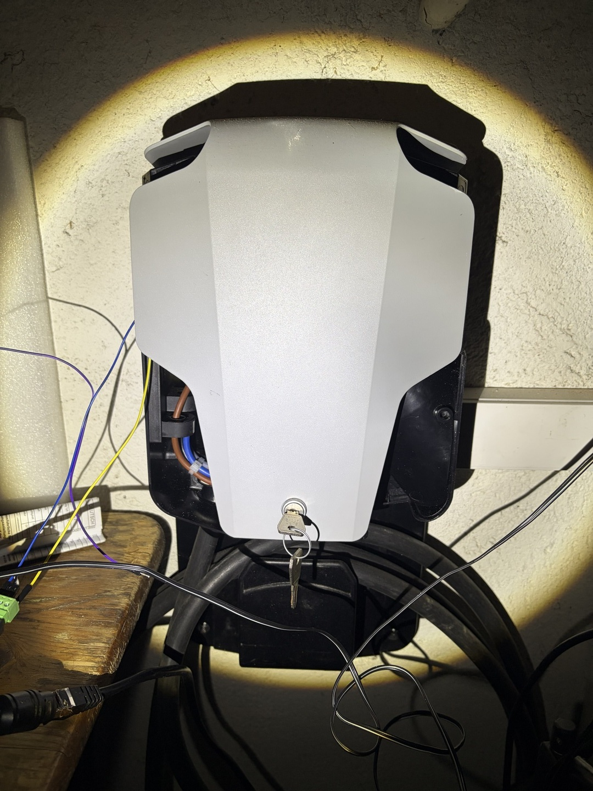
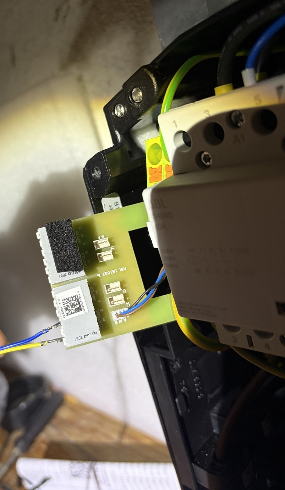

[](https://github.com/acpiccolo/ABL-EVCC-Wallbox/actions/workflows/check.yml)
[](https://deps.rs/repo/github/acpiccolo/ABL-EVCC-Wallbox)
[](https://github.com/acpiccolo/ABL-EVCC-Wallbox/blob/main/LICENSE-MIT)
[](https://github.com/acpiccolo/ABL-EVCC-Wallbox/blob/main/LICENSE-APACHE)
[](https://conventionalcommits.org)

# ABL eMH1 Modbus ASCII Library and Tool

This repository contains a Rust library and a command-line tool for interacting with **ABL eMH1** (and eMH2 / EVCC2/3) wallboxes via the **Modbus ASCII** protocol.

## Table of Contents
- [Hardware Requirements](#hardware-requirements)
- [Technical Documentation](#technical-documentation)
- [Technical Specifications](#technical-specifications)
- [Installation & Compilation](#installation--compilation)
- [Command-Line Usage](#command-line-usage)
- [Library Usage](#library-usage)
- [Cargo Features](#cargo-features)
- [License](#license)

---

## Hardware Requirements
To use this tool, you need:
- An **ABL eMH1** (or compatible EVCC2/3) wallbox.
- A **USB-to-RS485 converter** (e.g. FTDI / CH340 for local serial connection) or a **transparent Serial-to-Ethernet/WiFi gateway** (such as **Elfin EW11**, USR-TCP232, Protoss-PE11, etc.).

<p align="center">
  
</p>

### Hardware Connection & RS485 Pinout
The ABL eMH1 features an internal communication interface board (`ABL 181002`) with WAGO / RJ12 terminals for RS485 communication:

<p align="center">
  
</p>

- **A** (Data+ / RS485 A): Non-inverting RS485 data line
- **B** (Data- / RS485 B): Inverting RS485 data line
- **M / GND** (Common ground): Reference ground connection between RS485 transceiver and wallbox board

---

## Technical Documentation
For more detailed information, please refer to the official documentation and reference guides available in the [`docs/`](./docs/) directory:
- [`Schnittstellenbeschreibung_Modbus-ASCII.pdf`](./docs/Schnittstellenbeschreibung_Modbus-ASCII.pdf) – Official ABL EVCC2/3 Modbus ASCII interface specification.
- [`ABL_eMH1_Command_and_Value_Reference_DE.md`](./docs/ABL_eMH1_Command_and_Value_Reference_DE.md) – Ausführliche Befehls-, Werte- und Register-Referenz (Deutsch) mit Glossar (CP, CS, PWM, Duty Cycle, RDC-MD, etc.).
- [`ABL_eMH1_Command_and_Value_Reference_EN.md`](./docs/ABL_eMH1_Command_and_Value_Reference_EN.md) – Comprehensive Command, Value, and Register Reference (English) with glossary and technical field definitions.

---

## Technical Specifications

| Feature | Details |
|---|---|
| **Nominal Voltage** | 230/400V AC (3~) |
| **Operational Voltage** | 230V AC (1-phase) / 400V AC (3-phase) $\pm 10\%$ |
| **Current Control Range** | 6A to 80A per phase (in 0.1% duty cycle steps) or 0A (disabled) |
| **Communication Protocol** | Modbus ASCII (request starts with `:`, reply starts with `>`, LRC checksum) |
| **Baud Rates** | 9600, 19200, 38400 (Default), 57600 Bd |
| **Data Format** | 8E1 (Default: Even parity, 8 data bits, 1 stop bit), 8N1, 8O1, 8N2 |
| **Device Slave Address** | 1 to 16 (Default: 1, Broadcast: 0, Modbus max: 247) |

### Modbus ASCII Registers

| Register | Name / Function | Type | Description |
|:---:|:---|:---:|:---|
| **`0x0001`** | Read Device ID & Firmware | Read (2 words) | Hardware/PCBA revision, firmware version, and hardware flags (internal current sensor, RDC-MD, contactor monitor). |
| **`0x0003`** | Read Modbus Settings | Read (1 word) | Current baud rate (9600..57600 Bd), parity (None/Odd/Even), and stop bits (1 or 2). |
| **`0x0004`** | Read State Machine Status | Read (1 word) | Detailed state machine position: `0xA1` (Waiting for EV), `0xB1` (EV asking for charge), `0xB2` (EV permitted to charge), `0xC2` (Charging), error codes `0xF1`–`0xFB`. |
| **`0x0005`** | Modify State / Reset | Write (1 word) | `0xE0E0` (jump to E0 outlet disabled), `0xA1A1` (jump to A1 waiting for EV), `0x5A5A` (restart controller). Used for vehicle wake-up and reset. |
| **`0x0006`** | Read System Flags | Read (2 words) | State machine pointer, contactor feedback, upstream communication status, load imbalance, and overtemperature indicators. |
| **`0x0014`** | Set Maximum Current / Duty Cycle | Write (1 word) | Duty cycle in 0.1% steps (`Amperes / 0.06`). `1000` (`0x03E8`) = disabled / charging prohibited. |
| **`0x002E`** | Full Status & Phase Currents | Read (5 words) | Status byte, EV connection flag, configured current, and 3-phase currents in 0.1A resolution (`I_L1`, `I_L2`, `I_L3`). |

---

## Installation & Compilation

### Prerequisites
Ensure you have the following dependencies installed before proceeding:
- **Rust and Cargo**: Install via [rustup](https://rustup.rs/)
- **Git**: To clone the repository
- A C compiler and linker

### Building from Source
1. **Clone the repository**:
   ```sh
   git clone https://github.com/acpiccolo/ABL-EVCC-Wallbox.git
   cd ABL-EVCC-Wallbox
   ```
2. **Compile the project**:
   ```sh
   cargo build --release
   ```
   The compiled binary will be available at:
   ```sh
   target/release/abl-evcc
   ```
3. **(Optional) Install the binary system-wide**:
   ```sh
   cargo install --path .
   ```
   This installs `abl-evcc` to `$HOME/.cargo/bin`, making it accessible from anywhere.

---

## Command-Line Usage

### View Available Commands
To list all available commands and their options, run:
```sh
abl-evcc --help
```

### Connection Methods (`serial` vs `tcp`)

The tool provides two direct connection modes:
- **`tcp`**: Connects directly via TCP to transparent serial servers (such as **Elfin EW11**, USR-TCP232, Protoss-PE11, etc.) without requiring `socat`.
- **`serial`**: Connects via local serial devices (default: `/dev/ttyUSB0`) with configurable baud rate, parity, stop bits, address, and automatic serial delay timing verification.

#### 1. TCP Mode (Direct Network Connection via Serial Server, e.g. Elfin EW11)
```sh
abl-evcc tcp 192.168.3.128:8899 read-status
```
Options:
- `-s, --slave <SLAVE>`: Modbus slave ID (default: `1`)

#### 2. Serial Mode (Local Serial Port)
```sh
abl-evcc serial --device /dev/ttyUSB0 read-status
```
Configurable options:
- `-d, --device <DEVICE>`: Serial device path (default: `/dev/ttyUSB0`)
- `--baud-rate <BAUD>`: Baud rate (default: `38400`)
- `--parity-and-stop-bit <PARITY>`: Parity and stop bits (`ep1b` for 8E1 [default], `np1b` for 8N1, `op1b` for 8O1, `np2b` for 8N2)
- `--address <ADDRESS>`: Modbus slave address 1..16 (default: `1`)

---

### Ampere vs. Watt Definition

- **Ampere (`set-current`) ist pro Phase:**
  Die Wallbox signalisiert über das Control-Pilot-PWM-Signal die maximale Stromstärke pro Phase (6A bis 80A, oder 0A zum Stoppen).
- **Watt (`set-power`) gilt für 3 Phasen:**
  Die Wattangabe wird für ein 3-phasiges Netz ($3 \times 230\,\text{V} = 690\,\text{V}$) automatisch in die entsprechende Stromstärke pro Phase umgerechnet:
  $$\text{Ampere pro Phase} = \text{round}\left(\frac{\text{Leistung in Watt}}{3 \times 230\,\text{V}}\right)$$
  - Beispiel: `11000 W` $\rightarrow$ `16 A` pro Phase
  - Beispiel: `22000 W` $\rightarrow$ `32 A` pro Phase
  - Beispiel: `0 W` $\rightarrow$ `0 A` (Ladestopp)

---

### Available Commands

#### Read Wallbox Charging Status (`read-status`)
```sh
abl-evcc tcp 192.168.3.128:8899 read-status
```

#### Read All Measurements & Diagnostics (`read-all`)
Reads firmware info, system flags, and full measurements:
```sh
abl-evcc tcp 192.168.3.128:8899 read-all
```

#### Read 3-Phase Currents & Active Power (`read-currents`)
```sh
abl-evcc tcp 192.168.3.128:8899 read-currents
```

#### Read Configured Charging Current Limit (`read-current`)
```sh
abl-evcc tcp 192.168.3.128:8899 read-current
```

#### Set Charging Current in Amperes per Phase (`set-current`)
```sh
# Set limit to 16 Amperes per phase:
abl-evcc tcp 192.168.3.128:8899 set-current 16

# Stop / halt charging (0 Amperes, prompts for confirmation unless -f / --force is given):
abl-evcc tcp 192.168.3.128:8899 set-current 0 --force
```

#### Set Charging Power in Watts for 3 Phases (`set-power`)
```sh
# Set limit to 11000 Watts (3-phase, converts to 16A per phase):
abl-evcc tcp 192.168.3.128:8899 set-power 11000

# Stop / halt charging (0 Watts, prompts for confirmation unless -f / --force is given):
abl-evcc tcp 192.168.3.128:8899 set-power 0 --force
```

#### Enable / Disable Charging (`enable`, `disable`)
```sh
# Enable at 16A per phase:
abl-evcc tcp 192.168.3.128:8899 enable 16

# Enable specifying 3-phase power:
abl-evcc tcp 192.168.3.128:8899 enable --power 11000

# Disable charging (prompts for confirmation unless -f / --force is given):
abl-evcc tcp 192.168.3.128:8899 disable --force
```

#### Read Firmware & Hardware Configuration (`read-firmware`)
```sh
abl-evcc tcp 192.168.3.128:8899 read-firmware
```

#### Read Wallbox System Flags & State Machine Pointer (`read-system-flags`)
```sh
abl-evcc tcp 192.168.3.128:8899 read-system-flags
```

#### Read Modbus Communication Settings (`read-modbus-settings`)
```sh
abl-evcc tcp 192.168.3.128:8899 read-modbus-settings
```

#### Wake Up Vehicle (`wake-up`)
Cycles Control Pilot state (E0 -> wait 3s -> A1) to wake up sleeping EV onboard chargers:
```sh
abl-evcc tcp 192.168.3.128:8899 wake-up
```

#### Reset Controller (`reset`)
Sends command `0x5A5A` to restart the EVCC2 controller (prompts for confirmation unless `-f / --force` is given):
```sh
abl-evcc tcp 192.168.3.128:8899 reset --force
```

#### Bus Scan for Wallbox (`scan` and `serial-scan`)
Scans address range 0..=16 (checking default 38400 8E1 ID 1 and broadcast 0 first, then cycling through other baud rates/parities):
```sh
abl-evcc serial-scan --device /dev/ttyUSB0 --force
```

---

### Daemon Mode with MQTT

You can also run the tool as a daemon that periodically polls the wallbox and publishes measurements to an MQTT broker, or logs them to the console.

- **Log to Console:**
  ```sh
  abl-evcc tcp 192.168.3.128:8899 daemon console
  ```

- **Publish to MQTT:**
  ```sh
  abl-evcc tcp 192.168.3.128:8899 daemon mqtt --mqtt-config /path/to/mqtt.yaml
  ```
  If `--mqtt-config` is omitted, `mqtt.yaml` is loaded from the current working directory.

#### Published MQTT Topics:
- `<topic>/status`: State character (`A`, `B`, `C`, `D`, `E`, `F`)
- `<topic>/status_code`: Hex code (`0x00A1`, `0x00B1`, `0x00C2`, etc.)
- `<topic>/status_description`: Human-readable status description
- `<topic>/ev_connected`: Boolean (`true`/`false`)
- `<topic>/configured_current`: Configured charging current in Amperes per phase
- `<topic>/enabled`: Boolean indicating if charging is active (`true` if current >= 6A)
- `<topic>/current_l1`: Phase 1 current in Amperes
- `<topic>/current_l2`: Phase 2 current in Amperes
- `<topic>/current_l3`: Phase 3 current in Amperes
- `<topic>/power`: Total calculated active charging power in Watts
- `<topic>/JSON`: Full JSON object with all measurement values

#### Bidirectional Control via MQTT:
When `allow_control: true` is configured in `mqtt.yaml` (default: `false`), the daemon subscribes to `<topic>/set/#` and allows remote control:
- `<topic>/set/current`: Sets maximum current in Amperes per phase (e.g. `16` or `0` to stop). Capped by `max_current`.
- `<topic>/set/power`: Sets 3-phase power in Watts (e.g. `11000` or `0` to stop). Capped by `max_current`.
- `<topic>/set/enable`: Boolean (`true` / `on` to enable at `max_current`, `false` / `off` to disable).
- `<topic>/set/wake_up`: Set to `true` / `1` to trigger vehicle wake-up sequence.
- `<topic>/set/reset`: Set to `true` / `1` to restart the EVCC2 charge controller.

---

### MQTT Configuration (mqtt.yaml & Environment Variables)

All MQTT connection parameters are configured through a YAML file. This approach centralizes settings like the broker URL, credentials, topic, QoS, client ID, safety limits, and remote control permissions.

**Path Specification:**
- Use the `--mqtt-config <PATH>` option to specify the path to your MQTT configuration file. For example:
  ```sh
  abl-evcc tcp 192.168.3.128:8899 daemon mqtt --mqtt-config /path/to/your/mqtt.yaml
  ```
- If the `--mqtt-config <PATH>` option is **not** provided, the application will attempt to load `mqtt.yaml` from the current working directory.

If the specified configuration file (either via option or the default `mqtt.yaml`) is not found, cannot be read, or is improperly formatted, the program will exit with an error.

**Mandatory Fields:**
- The `uri` field within the MQTT configuration YAML file is **mandatory**.

**Configuration Details:**

The YAML file allows you to set the following parameters:
- `uri` (String, Mandatory): URI of the MQTT broker (e.g., `"tcp://localhost:1883"` or `"ssl://secure-broker:8883"`).
- `username` (String, Optional): Username for MQTT broker authentication.
- `password` (String, Optional): Password for MQTT broker authentication.
- `topic` (String, Optional): Base MQTT topic. Defaults to `"abl_evcc"` if not set.
- `qos` (Integer, Optional): MQTT Quality of Service level (0, 1, or 2). Defaults to `0` if not set.
- `client_id` (String, Optional): Client ID for the MQTT connection. If omitted, a random ID (e.g., `"abl-evcc-<random_suffix>"`) is generated.
- `operation_timeout` (Duration, Optional): Timeout for MQTT operations (e.g., `"10s"`).
- `keep_alive_interval` (Duration, Optional): MQTT keep-alive ping interval (e.g., `"30s"`).
- `auto_reconnect_interval_min` (Duration, Optional): Minimum automatic reconnect backoff interval (e.g., `"1s"`).
- `auto_reconnect_interval_max` (Duration, Optional): Maximum automatic reconnect backoff interval (e.g., `"30s"`).
- `allow_control` (Boolean, Optional): Enables remote control via MQTT (`<topic>/set/#`). Defaults to `false`.
- `max_current` (Integer, Optional): Maximum current cap in Amperes per phase allowed via MQTT. Defaults to `1` (1A safety limit).

**Example `mqtt.yaml`:**

```yaml
# Sample MQTT Configuration for ABL eMH1 Wallbox CLI

# URI of the MQTT broker (Mandatory).
uri: "tcp://localhost:1883"

# Username for MQTT broker authentication (optional).
# username: "your_username"

# Password for MQTT broker authentication (optional).
# password: "your_password"

# Base MQTT topic to publish measurements to.
# Defaults to "abl_evcc".
topic: "abl_evcc/garage/wallbox"

# MQTT Quality of Service (QoS) level for publishing messages.
# 0: At most once, 1: At least once, 2: Exactly once.
# Defaults to 0.
qos: 1

# Client ID for the MQTT connection (optional).
# If not provided, a random ID will be generated by the client library.
# client_id: "abl-evcc-main"

# Allow remote control via MQTT (subscribes to <topic>/set/#)
allow_control: false

# Maximum charging current cap in Amperes per phase allowed via MQTT
max_current: 16
```

#### Environment Variables Override

You can also override or specify configuration values via environment variables (useful for containerized environments or avoiding plain-text credentials in configuration files):

* `MQTT_URI`: Overrides `uri`
* `MQTT_USERNAME`: Overrides `username`
* `MQTT_PASSWORD`: Overrides `password`
* `MQTT_TOPIC`: Overrides `topic`
* `MQTT_CLIENT_ID`: Overrides `client_id`

---

## Library Usage

The `abl_evcc_lib` crate provides two main ways to interact with the ABL eMH1 wallbox:

1. **Synchronous Client**: [`tokio_sync::AsciiClient`] for blocking applications (serial ports or direct TCP).
2. **Asynchronous Client**: [`tokio_async::AsyncAsciiClient`] for async/await Tokio applications (serial ports or direct TCP).

### Quick Start: Synchronous Client

Here's a quick example of how to use the synchronous `AsciiClient` to read measurements and control current over a direct TCP connection.

#### Dependencies

First, add the required dependencies to your project:
```sh
cargo add abl_evcc_lib --no-default-features --features "tokio-sync,serde"
```

#### Example Usage

```rust
use abl_evcc_lib::tokio_sync::AsciiClient;
use std::time::Duration;

fn main() -> Result<(), Box<dyn std::error::Error>> {
    // Connect to the wallbox over a transparent TCP serial server
    let mut client = AsciiClient::connect_tcp(
        "192.168.3.128:8899",
        1,
        Duration::from_secs(3),
        Duration::from_millis(100),
    )?;

    // Read full measurements (status, 3-phase currents, active power, current limit)
    let measurements = client.read_measurements()?;
    println!("Measurements:\n{}", measurements);

    // Set maximum charging current to 16A per phase
    client.set_current(16)?;

    Ok(())
}
```

### Quick Start: Asynchronous Client (TCP and Serial)

```rust
use abl_evcc_lib::tokio_async::AsyncAsciiClient;
use std::time::Duration;

#[tokio::main]
async fn main() -> Result<(), Box<dyn std::error::Error>> {
    // Connect via direct TCP:
    let mut tcp_client = AsyncAsciiClient::connect_tcp(
        "192.168.3.128:8899",
        1,
        Duration::from_millis(100),
    ).await?;

    let measurements = tcp_client.read_measurements().await?;
    println!("Async TCP status: {:?}", measurements.status);

    // Or connect via asynchronous serial port (/dev/ttyUSB0):
    // let mut serial_client = AsyncAsciiClient::connect_serial(
    //     "/dev/ttyUSB0", 38400, tokio_serial::Parity::Even, tokio_serial::StopBits::One, 1, Duration::from_millis(100),
    // )?;

    Ok(())
}
```

---

## Cargo Features

This crate uses a feature-based system to minimize dependencies. When using it as a library, you should disable default features and select only the components you need.

- **`default`**: Enables `bin-dependencies`, intended for compiling the `abl-evcc` command-line tool.

### Client Features
- **`tokio-sync`**: Synchronous (blocking) Modbus ASCII client [`tokio_sync::AsciiClient`].
- **`tokio-async`**: Asynchronous (non-blocking) Modbus ASCII client [`tokio_async::AsyncAsciiClient`].

### Utility Features
- **`serde`**: Implements `serde::Serialize` and `serde::Deserialize` for protocol data structures.
- **`bin-dependencies`**: All features required to build the `abl-evcc` binary.

---

## License
Licensed under either of

 * Apache License, Version 2.0, ([LICENSE-APACHE](LICENSE-APACHE) or http://www.apache.org/licenses/LICENSE-2.0)
 * MIT license ([LICENSE-MIT](LICENSE-MIT) or http://opensource.org/licenses/MIT)

at your option.
